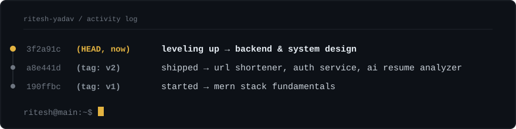

  

 

### about

I'm Ritesh — a computer science student building with the MERN stack. In the past few months I've shipped a URL shortener, an authentication system, and an AI-powered resume analyzer. Right now I'm going deeper into backend engineering: caching, SQL, system design — the stuff that separates "it works on my machine" from "it works at scale."

I also tinker with AI/ML — Python, scikit-learn, and LLM APIs — usually looking for an excuse to bolt some intelligence onto a normal app.

 

### stack

  

 

### currently

Going deeper on backend & system design — Redis caching, relational database design, auth patterns beyond a basic JWT, and the CS fundamentals (DSA, OS, DBMS, networks) that make the rest of it click.

 

### projects

  
  
   
  
  

 

### stats

  

 

### contact

  
  

